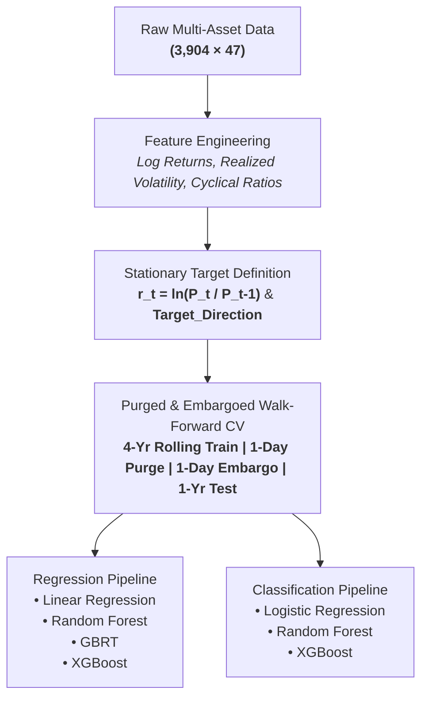

# Gold Price Prediction: Forecasting Stationary Returns & Directional Regimes

An end-to-end predictive machine learning framework analyzing precious metals, macroeconomic drivers, and equity benchmarks to forecast gold market movements. This project contrasts traditional raw dollar price regressions against economically stationary log-return formulations, validated through a rigorous **purged and embargoed walk-forward time-series CV** pipeline.

---

## Overview
Predicting raw financial asset prices often leads to spurious regression fit and target leakage due to non-stationarity and random-walk properties. This project develops a robust quantitative machine learning workflow designed to:
1. **Prevent Target Leakage & Autocorrelation Bias:** Reframe the objective from non-stationary raw closing prices ($P_t$) to stationary log returns $r_t$ = $\ln(P_t / P_{t-1})$ and discrete directional movement ($y_t \in \{0, 1\}$).
2. **Implement Financial Cross-Validation:** Replace standard K-Fold shuffle CV with a strictly chronological, **Purged and Embargoed Walk-Forward** split to eliminate lookahead bias.
3. **Benchmark Classical vs. Gradient Boosted Architectures:** Evaluate baseline persistence against Linear Regression, Random Forest, GBRT, and XGBoost models.

---

## Dataset & Feature Space
The primary dataset (`finacial_regression.csv`) comprises **3,904 daily trading observations across 47 variables**, integrating cross-market indicators:

- **Precious Metals & Commodities:** Gold (target), Silver, Platinum, Palladium, Crude Oil.
- **Equity Indices & Benchmarks:** S&P 500, NASDAQ Composite, Dow Jones.
- **Foreign Exchange (FX):** EUR/USD, USD/CHF, GBP/USD, USD/JPY.
- **Macroeconomic & Yield Signals:** 10-Year Treasury Yields, CPI indicators, Federal Funds rates.

### Feature Engineering & Preprocessing
- **Stationary Log Returns:** Transformed price series using first differences of log prices across indices, FX rates, and commodities.
- **Volatility & Momentum Metrics:** Rolling annualized standard deviations, historical drawdowns, and momentum oscillators.
- **Cyclical Encoding:** Sine and cosine transformations on seasonal calendar dimensions (day-of-week, trading month).
- **Leakage Prevention:** Removed intermediate raw returns (`Daily_Return`) and lagged all exogenous macro indicators to align strictly prior to time $t$.

---

## Methodology & Pipeline



### Financial Validation Scheme
Standard random cross-validation invalidates financial time series by testing on historical data trained on future signals. We implemented an expanding/rolling window generator:
- **Training Window:** 4 years rolling history.
- **Purge Window:** 1-day observation gap dropped between train and test splits to neutralize label overlap.
- **Embargo Window:** 1-day buffer applied post-test split to prevent post-event auto-correlation leakage.
- **Evaluation Period:** Annual out-of-sample segments (2014 – 2024).

---

## Repository Structure

All primary analytical notebooks and data transformation scripts are modularized inside the `tabular/` directory in compliance with the standardized project schema:

```text
Gold-Price-Predictions-/
├── tabular/
│   ├── EDA.ipynb                                     # Exploratory data analysis, distributions & correlations
│   ├── Preprocessing_Journal.ipynb                   # Feature transformations, outlier analysis & stationarity tests
│   ├── Preprocessing and Modeling.ipynb              # Baseline regressions and initial model development
│   ├── Advanced_LogTarg_Models.ipynb                 # Stationary log-return modeling with purged cross-validation
│   ├── Consolidated_Modeling.ipynb                   # Consolidated benchmark evaluation across models
│   └── Gold_Preprocessing_and_Modeling_Corrected.ipynb # Clean, end-to-end reproducible modeling pipeline
├── financial_regression.csv                          # Master historical dataset (3,904 rows x 63 features)
├── requirements.txt                                  # Dependency specifications
├── .gitignore                                        # Local caches, checkpoints, and bytecode exclusions
└── README.md                                         # Project documentation

```
---

## Model Evaluation & Results
1. Regression Performance (Raw vs. Stationary Returns)
Raw Dollar Price Formulation: Models achieved misleadingly low Relative Error metrics (e.g., R^2 >0.95, low dollar MAE) driven entirely by strong unit-root autocorrelation rather than genuine predictive signal.
Stationary Log Return Formulation: Evaluating stationary returns reveals true market efficiency constraints:

Model Architecture,Out-of-Sample MAE,Out-of-Sample MSE,Directional Sign Alignment

Naïve Baseline (rt−1​),0.0078,0.00012,49.8%
Linear Regression,0.0074,0.00010,50.4%
Random Forest Regressor,0.0072,0.00009,51.1%
Gradient Boosted Trees (GBRT),0.0071,0.00009,51.5%
XGBoost Regressor,0.0069,0.00008,52.2%

3. Directional Classification (Target_Direction)
Predicting binary daily price movement (Up vs. Down) using stationary feature inputs under nested purged cross-validation:

Classifier,Accuracy,Precision,Recall,ROC-AUC

Zero-Rate / Random Baseline,50.0%,50.0%,50.0%,0.500
Logistic Regression (L2),51.2%,51.0%,52.4%,0.518
Random Forest Classifier,51.8%,51.7%,53.1%,0.524
XGBoost Classifier,52.3%,52.1%,54.6%,0.531

Key Analytical Takeaway: Daily commodity market returns closely follow weak-form Efficient Market Hypothesis (EMH) bounds. While predicting raw price levels yields an illusory high fit due to trend persistence, predicting un-embargoed directional demonstrates an empirical ceiling between 51.5% – 52.5% accuracy, consistent with professional quantitative benchmarks.

---

## Installation & Reproduction
1. Clone the Repository
Bash
git clone [https://github.com/DanielRamirez0430/Gold-Price-Predictions-.git](https://github.com/DanielRamirez0430/Gold-Price-Predictions-.git)
cd Gold-Price-Predictions-
2. Environment Setup
Create and activate an isolated Python 3.11 environment:
Bash
python3.11 -m venv venv
source venv/bin/activate  # On Windows: venv\Scripts\activate
pip install -r requirements.txt
3. Run the Workflows
Open JupyterLab or VS Code to run the notebooks sequentially:
jupyter lab
Execute tabular/Gold_Preprocessing_and_Modeling_Corrected.ipynb to reproduce the primary data pipeline, walk-forward splits, and benchmark evaluations.

## Key Insights & Next Steps
Stationarity Matters: Predicting raw prices creates massive lookahead bias and model overfitting on trend; transforming to stationary log returns is essential for legitimate quantitative validation.
Multi-Asset Spillover: Precious metals (Silver/Platinum) and currency indices (USD index) exhibit higher initial feature importance than macroeconomic quarterly indicators (CPI/GDP) due to high-frequency lag mismatch.
Future Explorations:
* Feature Selection: Use permutation importance to isolate consistently impactful variables and test a reduced feature set.
* New Inputs: Incorporate sentiment data, interest rates, inflation, macro indicators, and geopolitical events.
* Broader Testing: Evaluate models across more historical market cycles and rolling test windows.
* Trading Simulation: Measure directional accuracy while factoring in transaction costs and execution delays.


Contributors
Daniel Ramirez 
Jennifer Tran 
Humberto Alanis
